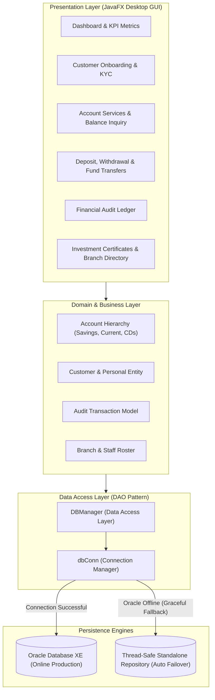
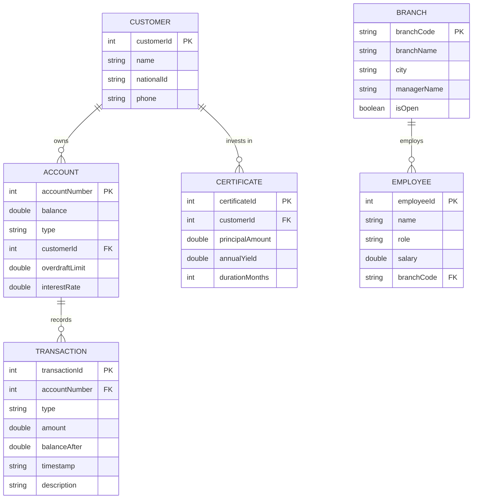

# 🏦 Enterprise Banking & Financial Management System

[](https://www.oracle.com/java/)
[](https://openjfx.io/)
[](#-dual-database-engine)
[](#-system-architecture)
[](LICENSE)

An enterprise-grade, desktop core banking application engineered with **Java 25** and **JavaFX**. Features an object-oriented financial domain model, **Savings** with compound interest, **Commercial Current Accounts** with overdraft facilities, **Inter-Account Atomic Fund Transfers**, **Certificates of Deposit (CDs)**, an immutable **Audited Transaction Ledger**, and a **Resilient Dual-Database Architecture** (Oracle Database XE with automatic in-memory failover).

---

## 📑 Table of Contents
- [System Architecture](#-system-architecture)
- [Database Entity-Relationship (ER) Diagram](#-database-entity-relationship-er-diagram)
- [Key Enterprise Features](#-key-enterprise-features)
  - [1. Account Polymorphism & Overdraft Protection](#1-account-polymorphism--overdraft-protection)
  - [2. Atomic Inter-Account Fund Transfers](#2-atomic-inter-account-fund-transfers)
  - [3. Audited Financial Transaction Ledger](#3-audited-financial-transaction-ledger)
  - [4. High-Yield Investment Certificates (CDs)](#4-high-yield-investment-certificates-cds)
  - [5. Commercial Branch & Staff Directory](#5-commercial-branch--staff-directory)
  - [6. Resilient Dual-Database Engine](#6-resilient-dual-database-engine)
- [Dashboard Walkthrough & Screenshots](#-dashboard-walkthrough)
- [Automated Verification Test Suite](#-automated-verification-test-suite)
- [Getting Started](#-getting-started)
- [Project Structure](#-project-structure)

---

## 🏛️ System Architecture



---

## 🗄️ Database Entity-Relationship (ER) Diagram



---

## 🌟 Key Enterprise Features

### 1. Account Polymorphism & Overdraft Protection
- **Abstract Base Account:** Standardizes account numbers, balance updates, and common formatting.
- **Savings Account (`SavingsAccount`):** Implements dynamic annual compound interest rates, monthly interest accrual calculation, and strict non-negative balance checks.
- **Current Account (`CurrentAccount`):** Features customizable **Overdraft Limits** (e.g. $1,000.00 buffer). Allows legitimate business transactions to proceed even when balance temporarily turns negative, strictly rejecting any request exceeding the combined balance and overdraft facility.

### 2. Atomic Inter-Account Fund Transfers
Transfers funds between any two bank accounts:
1. Validates that source and destination are distinct.
2. Checks that the source account possesses sufficient accessible funds (including overdraft buffer).
3. Atomically debits source account and credits destination account.
4. Generates twin audited transaction records (`TRANSFER_OUT` and `TRANSFER_IN`).

### 3. Audited Financial Transaction Ledger
Maintains an immutable audit log for every transaction:
- **Timestamped Audit:** Detailed down to the second.
- **Type Classification:** `DEPOSIT`, `WITHDRAWAL`, `TRANSFER_OUT`, `TRANSFER_IN`.
- **Pre & Post-Balance Accounting:** Tracks exact monetary balances before and after each movement.

### 4. High-Yield Investment Certificates (CDs)
Models fixed-term investment certificates (e.g. 12% to 18% APY):
- Calculates monthly dividend yield.
- Computes total cumulative payout at maturity.

### 5. Commercial Branch & Staff Directory
Integrates multi-branch bank coordination across Alexandria (Smouha, El Raml) and Cairo (Maadi):
- Tracks branch managers, phone coordinates, operating status (Open/Closed), and employee staff directory.

### 6. Resilient Dual-Database Engine
- **Production Mode:** Connects to **Oracle Database XE** via JDBC using parameterized prepared statements to eliminate SQL injection.
- **Resilient Fallback Mode:** When Oracle is offline or during testing, seamlessly switches to an embedded, thread-safe memory repository pre-seeded with sample customers, accounts, branches, and transactions. **Enables 100% out-of-the-box execution for reviewers with zero setup.**

---

## 🖥️ Dashboard Walkthrough

### 1. Central Executive Dashboard
Displays 4 real-time KPI metric cards (Total Capital Assets, Active Customers, Open Accounts, Operational Branches) and one-click quick actions.

### 2. Customer Management
Onboards clients with full KYC validation (Customer ID, Full Legal Name, 14-Digit National ID, Mobile Phone) and provides a searchable directory.

### 3. Account Operations & Live Balance Inquiry
Opens Savings and Current accounts, links accounts to customer profiles, and executes instant balance checks.

### 4. Transactions & Transfers
Dedicated visual panels for over-the-counter deposits, cash withdrawals, and inter-account atomic transfers.

### 5. Transaction Audit Ledger
Real-time chronological view of all banking movements with timestamps and status codes.

---

## 🧪 Automated Verification Test Suite

Includes automated unit tests verifying core financial rules:

```bash
# Run the built-in test suite
java -cp build/classes pkgfinal.Main --test
```

```text
==================================================================
       RUNNING ENTERPRISE BANKING AUTOMATED TEST SUITE            
==================================================================
[PASS] Test 1: Savings Account Deposit & Monthly Interest Accrual ✅
[PASS] Test 2: Current Account Overdraft Facility & Limit Enforcement ✅
[PASS] Test 3: Inter-Account Atomic Fund Transfer ($1,500.00) ✅
[PASS] Test 4: Investment Certificate 15% APY Yield & Maturity Valuation ✅
[PASS] Test 5: Strict Negative Amount Input Validation ✅

--------------------------------------------------
Test Results: 5 Passed, 0 Failed (Total 5)
STATUS: ALL BANKING SUITES PASSED! 🎉
--------------------------------------------------
```

---

## 🚀 Getting Started

### Prerequisites
- **JDK 17, 21, or 25** with JavaFX support (e.g. Azul Zulu with FX, BellSoft Liberica Full, or Oracle JDK with JavaFX SDK).

### Running via NetBeans IDE
1. Open NetBeans IDE.
2. Select **File** $\to$ **Open Project...**
3. Select this repository folder (`Final`).
4. Press **F6** or click **Run Project**.

### Running via Command Line
```bash
# Clone the repository
git clone https://github.com/mohamed-zizo-sketch/enterprise-banking-system.git
cd enterprise-banking-system

# Compile all source files
javac --add-modules javafx.controls,javafx.fxml -d build/classes src/pkgfinal/*.java

# Launch the Desktop GUI Application
java --add-modules javafx.controls,javafx.fxml -cp build/classes pkgfinal.Main

# Or run headless verification suite:
java --add-modules javafx.controls,javafx.fxml -cp build/classes pkgfinal.Main --test
```

---

## 📁 Project Structure

```text
enterprise-banking-system/
├── src/pkgfinal/
│   ├── Main.java                # Modern JavaFX multi-tab banking dashboard
│   ├── Account.java             # Abstract base account entity
│   ├── AccountOperations.java   # Banking operations contract interface
│   ├── SavingsAccount.java      # Savings account with compound interest
│   ├── CurrentAccount.java      # Current account with overdraft protection
│   ├── Certificate.java         # Certificates of Deposit (CD) investment model
│   ├── Transaction.java         # Financial ledger transaction record
│   ├── Person.java              # Abstract personal identity model
│   ├── Customer.java            # Banking client model
│   ├── Employee.java            # Bank staff and personnel entity
│   ├── Branch.java              # Commercial branch model
│   ├── Bank.java                # Top-level banking enterprise aggregate root
│   ├── dbConn.java              # Dual-engine connection manager
│   ├── DBManager.java           # Data Access Object (DAO) with failover
│   ├── BankTestSuite.java       # Automated verification test suite
│   └── Style.css                # Enterprise corporate stylesheet
├── .gitignore                   # Clean repository exclusions
├── LICENSE                      # MIT Open Source License
├── README.md                    # System architecture & documentation
└── build.xml                    # Standard Ant build script
```

---

## 📄 License
This project is open-source under the [MIT License](LICENSE).
